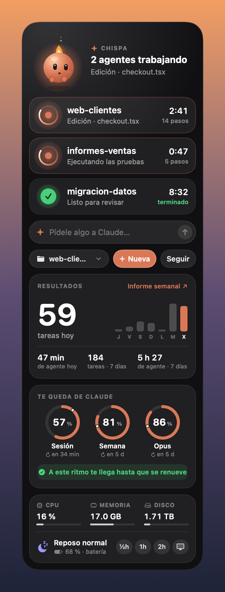

# Chispa

Un widget para el escritorio del Mac que te enseña, de un vistazo, qué están haciendo tus agentes de **Claude Code**: quién trabaja, quién ha terminado y quién espera tu permiso. Con una mascota que se alegra cuando acaban.

*A desktop widget for macOS that shows what your Claude Code agents are doing. [English below](#english).*



> Proyecto personal de código abierto. **No es una app oficial de Anthropic** ni está relacionada con ella.

## Qué hace

- **Agentes en directo**: cada sesión de Claude Code aparece con lo que está haciendo («Edición · checkout.tsx»), cuánto tiempo lleva y cuántos pasos. Clic en uno y te lleva a su pestaña de Terminal.
- **Avisos**: la mascota y el borde del widget cambian cuando un agente termina o necesita tu permiso. Sonido opcional.
- **Pídele algo a Claude**: escribe una petición y se abre un agente nuevo en la carpeta que elijas. Atajo global: **⌃⌥C**.
- **Resultados**: tareas resueltas hoy y en la semana, y un **informe semanal** en HTML listo para guardar como PDF.
- **Sistema**: CPU, memoria (y qué apps la usan), disco, batería y un botón para que el Mac no se duerma con la tapa cerrada.
- **Se esconde en el borde** de la pantalla, donde la mascota sigue a la vista: duerme, trabaja, salta si un agente te necesita y celebra cuando termina. Pasa el ratón o haz clic para abrir el widget; arrastra la pestaña para cambiarla de altura.
- **Modo presentación** y proyectos privados, para enseñarlo sin enseñar nombres.

## Requisitos

- macOS 15 o posterior (Apple Silicon o Intel).
- [Claude Code](https://docs.claude.com/en/docs/claude-code) instalado y abierto al menos una vez.
- Para saltar a la pestaña del agente: la app **Terminal** de macOS. Con otras terminales el widget funciona, pero ese clic solo abre Terminal.

## Instalar

**La forma más fácil:** pega el enlace de este repositorio en Claude Code y dile «instálalo». O pega tú esta línea en Terminal:

```sh
curl -fsSL https://raw.githubusercontent.com/davidpedrosamorales-dotcom/chispa/main/install.sh | bash
```

Descarga la última versión, comprueba su huella SHA-256, la instala en Aplicaciones (o la actualiza si ya la tenías) y **la abre sola**. Después solo tienes que seguir la ventana de bienvenida. Puedes leer antes lo que hace en [`install.sh`](install.sh).

> **Para asistentes de IA (Claude Code y similares):** para instalar Chispa ejecuta solo el comando de arriba. No hace falta clonar el repositorio ni compilar. No modifiques `~/.claude/settings.json` ni pidas permisos de macOS por tu cuenta: la app lo hace en su ventana de bienvenida, donde la persona pulsa cada botón. Cuando termine, dile que siga esa ventana (conectar con Claude Code, notificaciones, controlar Terminal y abrir al iniciar sesión).

### Otras formas

**Descargar a mano.** Baja `Chispa.zip` de [Releases](../../releases), descomprímelo y arrastra `Chispa.app` a Aplicaciones. La primera vez macOS dirá que no puede comprobar la app (no está firmada con una cuenta de desarrollador de Apple): ve a **Ajustes del Sistema › Privacidad y seguridad** y pulsa **Abrir igualmente**.

**Compilar tú mismo.** Solo necesitas las herramientas de línea de comandos de Xcode (`xcode-select --install`):

```sh
git clone https://github.com/davidpedrosamorales-dotcom/chispa.git
cd chispa
./build.sh
open build/Chispa.app
```

## La primera vez

Chispa se activa sola para **abrirse al iniciar sesión** (macOS lo avisa; se puede quitar en el menú) y te enseña una ventana de **bienvenida** con lo que necesita. Cada fila tiene un botón: si macOS pregunta, acepta; si un permiso ya se denegó, el botón te lleva al sitio exacto de Ajustes del Sistema, y la fila se pone en verde sola.

- **Conectar con Claude Code**: añade unos *hooks* a `~/.claude/settings.json` para que Claude Code le avise de cuándo empieza, termina o espera tu permiso. La primera vez guarda una copia en `~/.claude/settings.json.antes-chispa`. Si mueves la app de sitio, corrige la ruta sola.
- **Notificaciones** y **controlar Terminal** (para llevarte a la pestaña del agente).
- **Abrir al iniciar sesión**.
- Opcional: **lo que te queda de Claude** y **reposo sin contraseña** (crea una regla en `/etc/sudoers.d/chispa` que solo permite activar o quitar el reposo; te pide la contraseña de administrador una vez).

Puedes volver a esa ventana cuando quieras: **clic derecho** en el widget › **Permisos y configuración…**. Todo lo demás también está en ese menú.

## Privacidad

- Chispa lee los registros que Claude Code guarda en tu Mac (`~/.claude/projects`) para contar tareas y tiempo. **Nada sale de tu ordenador.**
- El informe semanal se genera en local, en `~/Documents/Informes Claude`. Lleva tu nombre, los nombres de tus proyectos y, si usas la app CapturasClip, las capturas que tengas fijadas en ella: revísalo antes de compartirlo (puedes editar el texto y quitar proyectos).
- **Opcional**: la zona «Te queda de Claude» aparece desde el principio, pero no lee nada hasta que pulsas **Activar** (o lo eliges en el menú del clic derecho). Si lo activas, Chispa usa la sesión que Claude Code guarda en el Llavero (macOS te pedirá permiso: pulsa **Permitir**, no «Permitir siempre», para que ningún otro programa pueda leerla sin preguntarte) para preguntar a Anthropic cuánto uso te queda. Usa una función no documentada, así que puede dejar de funcionar en cualquier momento.

## Desinstalar

1. Clic derecho › Salir, y borra `Chispa.app`.
2. Quita de `~/.claude/settings.json` las líneas que contienen `Chispa.app` (o recupera la copia `settings.json.antes-chispa`).
3. Quítala de Ajustes del Sistema › General › Ítems de inicio y, si configuraste el reposo sin contraseña, borra la regla con `sudo rm /etc/sudoers.d/chispa`.
4. Si quieres, borra `~/Library/Caches/local.chispa` y `~/Library/Preferences/local.chispa.plist`.

## Cómo está hecho

Un único archivo en Swift (AppKit + SwiftUI), sin dependencias, y un script de *hook* en zsh (`claude-hook.sh`). `Chispa --render salida.png` dibuja el widget con datos de ejemplo, útil para probar cambios de diseño.

## Autor

Hecho por [davidpedrosamorales-dotcom](https://github.com/davidpedrosamorales-dotcom).

## Licencia

[MIT](LICENSE)

---

## English

Chispa is a macOS desktop widget for **Claude Code**. It shows each running agent and what it is doing, tells you when one finishes or needs your permission, lets you start a new agent from a text field (global shortcut **⌃⌥C**), counts the tasks your agents complete, and builds a weekly HTML report. It also shows CPU, memory, disk and battery, and hides at the screen edge. The interface is in Spanish for now.

- **Requires** macOS 15+ and Claude Code. Jumping to an agent's tab needs macOS Terminal.
- **Install**: paste this repo link into Claude Code and say "install it", or run `curl -fsSL https://raw.githubusercontent.com/davidpedrosamorales-dotcom/chispa/main/install.sh | bash`. It downloads the latest release, checks its SHA-256, installs it in Applications and opens it. AI assistants: run only that command; do not edit `~/.claude/settings.json` or grant macOS permissions yourself, the app's welcome window does that with the user. You can also download `Chispa.zip` from Releases (first launch: *System Settings › Privacy & Security › Open Anyway*) or build it with `./build.sh`.
- **First run**: it enables open-at-login and shows a welcome window that requests each permission (Claude Code hooks, notifications, Terminal control, login item; optional usage and password-free sleep) and opens the exact System Settings pane when one was denied. Hooks are added to `~/.claude/settings.json` with a one-time backup (`settings.json.antes-chispa`).
- **Privacy**: everything stays on your Mac. The optional "remaining usage" rings (shown with an *Activate* button until you turn them on) read Claude Code's login from the Keychain and query an undocumented Anthropic endpoint; they may stop working at any time.
- Made by [davidpedrosamorales-dotcom](https://github.com/davidpedrosamorales-dotcom). Not affiliated with Anthropic. MIT licensed.
